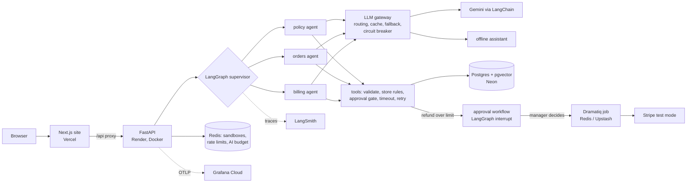

# Brightwood Support Agent

A multi-agent customer-support system for a (fictional) online home-goods store. A **LangGraph supervisor** routes each
customer message to a **policy**, **orders** or **billing** specialist. The specialists answer from the store's help articles
(**RAG over pgvector**), look up and act on the customer's real orders through **validated tool calls**, and send refunds
above a limit to a **human manager** through a durable approval workflow. Every rule that matters (refund limits, return
windows, data isolation) is enforced in code *below* the model, so a fooled or failing model still cannot break it.

The store's customers, orders and products are invented. Everything else is real, running software: the API, the agents,
the database, the job queue, the staff console, the evals and the deployment.

## Architecture



## Stack, and why each piece is here

| Layer | Technology | What it does in this project |
|---|---|---|
| Agents | **LangGraph** | Supervisor graph and specialist agents. Least privilege: the policy agent cannot see orders or move money. `interrupt()` + a Postgres checkpointer make manager approvals durable across restarts. |
| Models | **LangChain** + **Gemini** | One adapter (`providers.py`) for any tool-calling chat model; Gemini on the API or a fine-tuned model on Vertex AI. |
| Reliability | own **LLM gateway** | Fast/strong routing, response cache, provider fallback, circuit breaker, offline fallback, per-provider stats. |
| API | **FastAPI** | Typed request models, OpenAPI docs at `/api/docs`, request ids, security headers. |
| Data | **Postgres + pgvector** (Neon) | One schema per visitor sandbox; approvals and history persist; hybrid search (word + Gemini embedding vectors). |
| State | **Redis** (Upstash) | Live sandboxes, sliding-window rate limits, a daily AI-call budget shared by all instances, sign-in lockouts. |
| Jobs | **Dramatiq** on Redis | Manager decisions and Stripe webhooks run in the background with retries; idempotency keys make retries safe. |
| Frontend | **Next.js 16**, React 19, TypeScript, Tailwind, TanStack Query | Shop, orders, help search, staff console with business metrics, chat with voice, a "behind the scenes" inspector. |
| Evals | unittest, scenario evals, **openevals** LLM-as-judge, **LangSmith** | Safety in code, quality by a calibrated judge, experiments compared in LangSmith. |
| Fine-tuning | **Vertex AI** supervised tuning | Distil a strong teacher into a small student; adopt only if it matches the evals and costs less. |
| Observability | JSON logs, **OpenTelemetry** to **Grafana Cloud**, LangSmith | Request ids in every log line; every route, model call and tool call is a span. |
| Infra | **Docker**, **Terraform**, **GitHub Actions** | Neon, Upstash, Render and Vercel as code; CI runs lint, tests (incl. Postgres), evals, build, image smoke test, `terraform validate`. |

## Run it locally

Everything works offline with no accounts: SQLite instead of Postgres, an in-process fake Redis, jobs run inline,
and a rule-based offline assistant instead of Gemini (same agents, tools and safety checks).

```bash
python -m venv .venv && . .venv/Scripts/activate       # Windows; use .venv/bin/activate elsewhere
pip install -r requirements-dev.txt
PYTHONPATH=src python -m brightwood_support.server      # API on http://localhost:8000, docs at /api/docs
```

```bash
cd web && npm install && npm run dev                    # site on http://localhost:3000
```

To use the real model, copy `.env.example` to `.env` and set `GEMINI_API_KEY` and `GEMINI_MODEL`. To use Postgres and
Redis locally, set `DATABASE_URL` and `REDIS_URL` (the tests can start an embedded Postgres with pgvector, see below).

## Tests and evals

| Check | Command | Result now |
|---|---|---|
| Unit + API tests | `PYTHONPATH=src python -m unittest discover` | 89 pass |
| Postgres integration (restart survival, pgvector, rules) | `TEST_DATABASE_URL=postgresql://... python -m unittest tests.test_postgres` | 4 pass (CI uses a `pgvector/pgvector` container) |
| Agent safety scenarios, single and multi-agent | `PYTHONPATH=src python -m brightwood_support.agent_eval` | 26/26 and 26/26 |
| End-to-end conversations, code checks | `python evals/run_conversation_eval.py` | 24/24 with the offline assistant |
| Retrieval gate (word search) | `python evals/run_retrieval_eval.py` | hit@3 0.76, MRR 0.74 |
| Live model + LLM judge | `python evals/run_conversation_eval.py --live --judge` | run with your key (also the `live-evals` workflow) |
| Hybrid retrieval with Gemini embeddings | `python evals/run_retrieval_eval.py --semantic` | run with your key |
| Judge calibration against human labels | `python evals/run_conversation_eval.py --calibrate` | run with your key |

The split is deliberate: **safety is checked by code** (did money move, did another customer's data leak, did the right
agent and tool run), and **quality is graded by a judge model** (is the answer grounded in the retrieved articles, does it
match the reference answer). The judge is only trusted after it agrees with hand-labelled examples.

## Business metrics and success targets

`GET /api/metrics` (and the staff page) reports, across all visitors: containment rate (resolved without a person),
escalation and approval rates, failure rate, rule blocks, injection attempts, model fallback rate, p50/p95 latency,
tokens and cost per conversation, and manager approval wait. Each is compared with a target in `runlog.py`:

| Target | Goal |
|---|---|
| Resolved without a person | ≥ 60% |
| Turns that stopped early | ≤ 2% |
| p95 time to answer | ≤ 8 s |
| Model cost per conversation | ≤ $0.01 |
| Median wait for a manager | ≤ 4 h |

## Fine-tuning (distillation)

```bash
python finetune/build_dataset.py            # teacher = GEMINI_STRONG_MODEL; --dry-run uses the offline assistant
python finetune/launch_vertex.py --train gs://.../train_vertex.jsonl --val gs://.../val_vertex.jsonl   # --submit to start
python finetune/compare.py --base <model> --candidate <tuned endpoint> --candidate-vertex --judge
```

Prompts are synthetic and **held out from the evals**; trajectories are kept only if they finish cleanly, make no invalid
tool calls, match the prompt's intent and contain nothing private. Data is exported for Vertex AI Gemini and in the OpenAI
format. The tuned model is adopted only if its eval pass rate is no lower, judge scores do not drop, and it is cheaper or faster.

## Deploy (free tiers)

1. Push to GitHub, and connect the repository to Render and Vercel (one-time, in their dashboards).
2. Create accounts/API keys: Neon, Upstash, Render, Vercel, and a Gemini API key. Optional: Grafana Cloud, LangSmith.
3. `cd infra/terraform && cp terraform.tfvars.example terraform.tfvars`, fill it in, then
   `terraform init && terraform plan && terraform apply`. It creates the database, Redis, the API service and the site,
   and wires `API_URL` into Vercel.
4. Open `<api>/api/health`: `database` should say `postgres`, `redis` `true`, `jobs` `redis-queue`.

Without Terraform: create the Neon database and Upstash Redis by hand, deploy the API with `render.yaml` (Blueprint),
and import the repo in Vercel with root directory `web` and `API_URL` set to the Render URL.

## Security notes

- The customer id comes from the session, never from the model; no tool takes one, and no tool deletes anything.
- Staff tokens are RS256 JWTs (algorithm pinned, issuer/audience/expiry checked). Demo mode lets visitors try both roles;
  production sets `DEMO_STAFF_LOGIN=false` and `STAFF_ACCESS_CODE` (5 attempts per 5 minutes per client).
- Card numbers, secrets and other customers' emails are masked before the model sees them and before anything is stored.
- Stripe live keys are refused; webhooks are signature-checked with replay protection.
- Each visitor's sandbox is an isolated Postgres schema, named from a hash of the session id.

## Project layout

```
src/brightwood_support/   agent.py (LangGraph supervisor + specialists), workflows.py (approval interrupt), service.py,
                          server.py (FastAPI), shop.py (rules + SQL), db.py (SQLite/Postgres), state.py (Redis), jobs.py,
                          gateway.py, providers.py, rag/ (pgvector hybrid search), runlog.py (metrics), telemetry.py,
                          conversation_eval.py, judges.py, finetune.py, mcp_server.py
web/                      Next.js site
evals/                    eval cases, judge calibration, runners
finetune/                 dataset builder, Vertex launcher, base-vs-tuned comparison
infra/terraform/          Neon, Upstash, Render, Vercel
tests/                    unit, API, Postgres integration, eval and fine-tuning tests
```

## Honest limits

- Gemini has not been called from the build environment: the LangChain adapter is tested against a fake chat model.
  Run the `live-evals` workflow (or the commands above) to get the real numbers.
- Stripe test mode, Upstash, Grafana Cloud, LangSmith and Vertex tuning are wired and unit-tested but not yet exercised
  against the real services. Postgres + pgvector and the LangGraph Postgres checkpointer *are* tested against a real Postgres.
- The offline assistant is rules, not an LLM; offline eval results measure the harness, not model judgement.
- The semantic-score calibration constant (`SEMANTIC_FLOOR` in `rag/semantic.py`) should be checked with `--semantic`.
- Render's free instance has 512 MB of memory; LangChain and LangGraph fit, but watch it under load.
