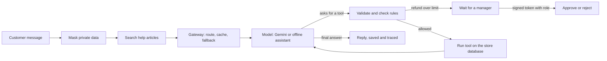

# Brightwood Support Agent

Brightwood Goods is a made-up home goods store. The Brightwood Support Agent is its support assistant: it answers from the store's
help articles, looks up and acts on a customer's orders, and sends refunds above $50 to a person. The website,
the assistant, the database and the staff console are all real working software. Only the store's customers,
orders and products are invented.

**One-minute explanation.** A customer types a message. The server hides private data, searches the help
articles, and hands the best passages plus the customer's question to a language model. The model can only ask
for one of seven tools. The code validates each request, checks the store's rules and the approval limits, runs
it, and gives the result back until the model can answer. Everything is saved and timed, so any answer can be
traced. The rules live below the model, so a fooled model still cannot break them.

## Run it

```bash
pip install -r requirements.txt
PYTHONPATH=src python -m brightwood_support.server        # http://localhost:8000
```

With no key set, the built-in offline assistant answers (rules, not an LLM, but it uses the same tools and the
same safety checks). To use Gemini, set `GEMINI_API_KEY` and `GEMINI_MODEL` (see `.env.example`). The gateway
then tries Gemini first and falls back to the offline assistant on error, timeout or after `DAILY_AI_CALLS`.

## Deploy free on Render

1. Push this repo to your GitHub. 2. On render.com choose New, Blueprint, pick the repo (it reads `render.yaml`).
3. In the service's Environment tab add `GEMINI_API_KEY` and `GEMINI_MODEL`. The free service sleeps when idle
and wakes in under a minute. Recheck Render's and Google's free-tier limits before you launch.

## Payments (Stripe test mode)

With `STRIPE_SECRET_KEY` set to a Stripe **test** key, an allowed refund really calls Stripe: the seeded order
gets a test payment (card `pm_card_visa`), then Stripe's refund API is called with the amount and an idempotency
key. The refund id and status are saved, and the orders page links to the refund in the Stripe test dashboard.
A signed webhook at `/api/stripe/webhook` (secret in `STRIPE_WEBHOOK_SECRET`) updates the status later. Live keys
(`sk_live_...`) are refused on purpose. With no key, a simulator records fake ids so everything else still works.

## Voice

The chat has a microphone button and a Voice switch. Speech recognition and speech synthesis come from the visitor's
browser (Chrome, Edge and Safari; Firefox has no recognition), so there is no extra service and no cost. Chrome may send
the audio to Google to transcribe it, and the page says so. The spoken text goes through the same agent, tools, rules,
approval gate and masking as typed text. Before any spoken refund or cancellation the page reads the request back and waits
for a spoken yes. Voice quality depends on the device's installed voices; the voice code is small enough to swap for a
paid or neural voice later.

## How a message travels



## Concepts and where they live

| Concept | What it means here | Code |
|---|---|---|
| Retrieval (RAG) | Search the help articles first, give the best passages to the model as context | `rag/`, `data/help/` |
| Tool calling | The model only asks; code validates and runs; unknown tools and bad arguments are rejected | `tools.py`, `agent.py` |
| Least privilege | No tool takes a customer id or deletes anything; money moves only via `request_refund` | `tools.py`, `shop.py` |
| Rules below the model | Cancel/return/refund rules are enforced in the data layer | `shop.py` |
| Human in the loop | Refunds over $50 (or $100 per chat) wait for a support manager | `approvals.py` |
| Roles and sign-in | RS256 tokens, issuer/audience/expiry checked, role from the groups claim | `auth.py`, `idp.py` |
| Prompt injection | Customer text is data; flagged and logged; the rules do not depend on the model behaving | `guardrails.py`, `agent.py` |
| PII masking | Card numbers, secrets and other people's emails hidden on the way in and out | `guardrails.py` |
| Voice | Browser speech in and out, spoken-style instruction to the model, read-back before money actions | `web/site/app.js`, `service.py` |
| Payments | Refunds call Stripe (test mode) after the rules and approval pass; idempotency key; signed webhooks | `payments.py` |
| LLM gateway | Fast/strong routing, response cache, provider fallback, circuit breaker, per-provider stats | `gateway.py`, `providers.py` |
| Cost control | Token budget, step cap, daily real-model cap, cache | `agent.py`, `service.py` |
| Observability | A timed span per model and tool call, a run row per question, an audit log | `tracing.py`, `shop.py` |
| Evals | 21 scenarios that attack the harness, plus a retrieval-quality gate, run in CI | `agent_eval.py`, `evals/` |
| MCP | The same tools and safety rules offered to any MCP client | `mcp_server.py` |
| Sandboxing | Every visitor gets a private in-memory database, deleted after 30 minutes | `service.py` |

## Checks

```bash
PYTHONPATH=src python -m unittest discover -q      # 63 tests
PYTHONPATH=src python -m brightwood_support.agent_eval      # 21 scenarios
PYTHONPATH=src python evals/run_retrieval_eval.py  # retrieval gate (hit@3 0.76, MRR 0.74 on 25 questions)
```

## Honest limits

- Stripe has never been called from the build environment either (it is not reachable from here); `payments.py` is tested against a fake HTTP function and a computed webhook signature.
- Gemini has never been called from the build environment; `providers.py` is tested only against a fake HTTP function. Expect a small fix on the first real call (model id, field names).
- The offline assistant is rules, not an LLM. The agent scenarios test the harness, not a model's judgement; running them against a real model is a separate step.
- Search matches words, not meaning (misses: "broken" vs "damaged", "charged twice" vs "double charge"). Next step: embeddings from a model, then combine with word matching.
- The router (fast vs strong model) is a heuristic that a real-model eval has to confirm.
- The staff sign-in is a built-in provider so visitors can try both roles. A real deployment uses Okta, Auth0 or Cognito.
- Per-visitor data lives in memory on one server process; scaling out would need Postgres and a shared session store.
